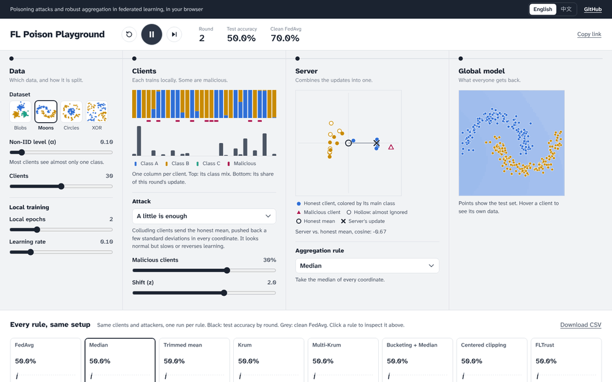

# FL Poison Playground

Poisoning attacks and robust aggregation in federated learning, running in your browser.

**[Open the playground](https://calvin1989.github.io/fl-poison-playground/)** · [中文说明](README.zh-CN.md)



Split a dataset across clients, from IID to extreme Non-IID. Turn some of the clients malicious. Pick the rule the server uses to combine updates, and watch the global model hold or break, round by round. Every rule also runs side by side on the same setup, so you can compare them at a glance.

To see the trend rather than one setup, sweep a setting: every rule runs at each Non-IID level (or each share of malicious clients), and the results download as CSV.

## Things to try

- **Plain averaging has no defense.** Six clients flip their updates and FedAvg collapses. Switch to Median and it recovers.
- **Non-IID data opens the door.** "A little is enough" barely dents Median on IID data. Drag the Non-IID slider down and Median falls to chance.
- **Averaging first helps.** Bucketing averages a few random clients at a time before taking the median, and holds up under the same attack.

Every setup has its own link, so you can share exactly what you are looking at.

## What's inside

| | |
| --- | --- |
| Attacks | Label flipping, sign flipping, random noise, A little is enough (ALIE), inner product manipulation (IPM) |
| Defenses | FedAvg, Median, Trimmed mean, Krum, Multi-Krum, Bucketing, Centered clipping, FLTrust |
| Data | Four 2D datasets, split across 10 to 50 clients with a Dirichlet(α) class mix |
| Languages | English, 中文 |

The model is a small neural network written from scratch in TypeScript. There is no server and no ML library.

## Add your own defense

Attacks and defenses are entries in a list. Add one to `AGGREGATORS` in [`src/core/aggregators.ts`](src/core/aggregators.ts) and it shows up in the controls and the comparison. Text without a Chinese translation falls back to English:

```ts
{
  id: "norm-clip",
  name: { en: "Norm clipping", zh: "范数裁剪" },
  description: { en: "Shrink every update to the median length, then average." },
  aggregate: (updates) => {
    const norms = updates.map(norm);
    const limit = [...norms].sort((a, b) => a - b)[Math.floor(norms.length / 2)];
    const clipped = updates.map((u, i) => scale(u, Math.min(1, limit / norms[i])));
    return { update: mean(clipped), influence: updates.map(() => 1 / updates.length) };
  },
},
```

New attacks go in `ATTACKS` in [`src/core/attacks.ts`](src/core/attacks.ts) the same way.

## Run locally

```bash
npm install
npm run dev
```

`npm test` checks the math and that every scenario still shows what it claims to.

## Credits

Inspired by [TensorFlow Playground](https://playground.tensorflow.org). The attacks and defenses follow their original papers:
[ALIE](https://arxiv.org/abs/1902.06156),
[IPM](https://arxiv.org/abs/1903.03936),
[Krum](https://proceedings.neurips.cc/paper/2017/hash/f4b9ec30ad9f68f89b29639786cb62ef-Abstract.html),
[Median and Trimmed mean](https://arxiv.org/abs/1803.01498),
[Bucketing](https://arxiv.org/abs/2006.09365),
[Centered clipping](https://arxiv.org/abs/2012.10333),
[FLTrust](https://arxiv.org/abs/2012.13995).

MIT licensed.
