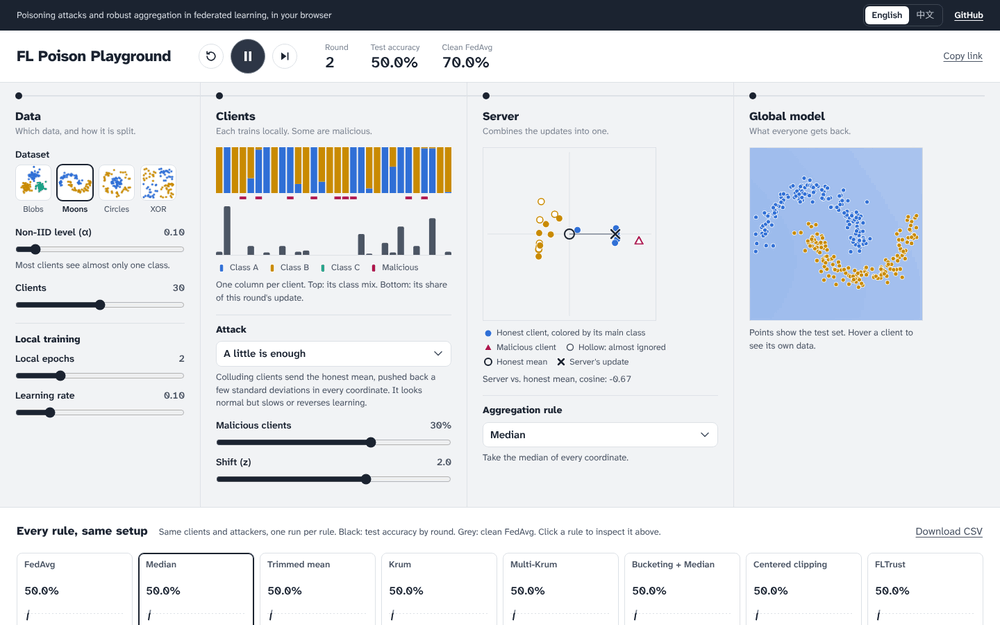

# FL Poison Playground

在浏览器里直接看联邦学习的投毒攻击和鲁棒聚合是怎么较量的。

**[打开 Playground](https://calvin1989.github.io/fl-poison-playground/?lang=zh)** · [English](README.md)



把数据分给各个客户端，可以从 IID 一直调到极端 Non-IID；让一部分客户端变成恶意的；再选服务器用哪种规则合并更新。然后一轮一轮地看全局模型是守住了还是崩了。所有聚合规则还会在同一设置下并排运行，一眼就能比较。

想看趋势而不只是某一个设置，可以做敏感性扫描：每种规则在每个 Non-IID 程度（或每个恶意比例）下各跑一次，结果能下载成 CSV。

## 可以试试

- **普通平均没有任何防御。** 6 个客户端把更新方向反过来，FedAvg 就崩了。换成 Median，模型又恢复。
- **Non-IID 给了攻击者机会。** 在 IID 数据上，ALIE 几乎伤不到 Median。把 Non-IID 滑块往下拖，Median 就掉到随机水平。
- **先平均再取中位数有用。** Bucketing 每次随机取几个客户端先平均，再取中位数，在同样的攻击下能守住。

每种设置都有自己的链接，可以把你看到的画面原样分享给别人。

## 包含什么

| | |
| --- | --- |
| 攻击 | 标签翻转、符号翻转、随机噪声、A little is enough (ALIE)、内积操纵 (IPM) |
| 防御 | FedAvg、Median、Trimmed mean、Krum、Multi-Krum、Bucketing、Centered clipping、FLTrust |
| 数据 | 4 个二维数据集，按 Dirichlet(α) 类别分布分给 10 到 50 个客户端 |
| 界面语言 | English、中文 |

模型是用 TypeScript 从零写的小神经网络，不需要服务器，也不依赖任何机器学习库。

## 添加你自己的防御方法

攻击和防御都是列表里的一项。在 [`src/core/aggregators.ts`](src/core/aggregators.ts) 的 `AGGREGATORS` 里加一项，界面和对比图里就会出现这个选项。没写中文的文字会自动显示英文：

```ts
{
  id: "norm-clip",
  name: { en: "Norm clipping", zh: "范数裁剪" },
  description: { en: "Shrink every update to the median length, then average." },
  aggregate: (updates) => {
    const norms = updates.map(norm);
    const limit = [...norms].sort((a, b) => a - b)[Math.floor(norms.length / 2)];
    const clipped = updates.map((u, i) => scale(u, Math.min(1, limit / norms[i])));
    return { update: mean(clipped), influence: updates.map(() => 1 / updates.length) };
  },
},
```

新的攻击用同样的方式加到 [`src/core/attacks.ts`](src/core/attacks.ts) 的 `ATTACKS` 里。

## 本地运行

```bash
npm install
npm run dev
```

`npm test` 会检查数学计算，并确认每个预设场景仍然能演示出它所描述的现象。

## 致谢

灵感来自 [TensorFlow Playground](https://playground.tensorflow.org)。各攻击和防御方法按原论文实现：
[ALIE](https://arxiv.org/abs/1902.06156)、
[IPM](https://arxiv.org/abs/1903.03936)、
[Krum](https://proceedings.neurips.cc/paper/2017/hash/f4b9ec30ad9f68f89b29639786cb62ef-Abstract.html)、
[Median 和 Trimmed mean](https://arxiv.org/abs/1803.01498)、
[Bucketing](https://arxiv.org/abs/2006.09365)、
[Centered clipping](https://arxiv.org/abs/2012.10333)、
[FLTrust](https://arxiv.org/abs/2012.13995)。

MIT 协议。
